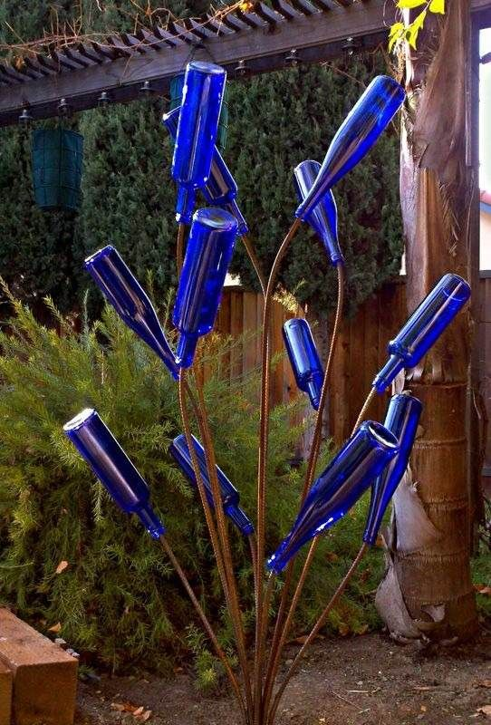
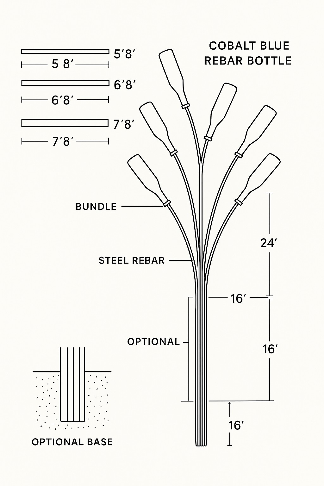

A **bottle tree** is a classic piece of Southern folk art — a sculpture made from glass bottles mounted on metal “branches.” This version uses simple ½″ rebar, creating a striking cobalt blue garden accent that’s durable, inexpensive, and easy to build.

---

## 🖼️ Completed Project

*An example of a finished rebar bottle tree using cobalt blue bottles.*

---

## 🧰 Materials

| Quantity | Material | Length | Notes |
|-----------|-----------|---------|--------|
| 4 | ½″ rebar rods | 20 ft each | Cut into varying lengths |
| 16 | Glass bottles | — | Cobalt blue recommended |
| — | Wire or hose clamps | — | For bundling rebar |
| — | Quick-set concrete *(optional)* | — | For stability |
| — | Rust-resistant enamel spray | — | Clear or black finish |

---

## ✂️ Cut List

Each 20′ rebar rod is cut into three pieces:

| Piece | Length | Description |
|--------|---------|-------------|
| A | 5′ 8″ | Short branch |
| B | 6′ 8″ | Medium branch |
| C | 7′ 8″ | Long branch |

This yields **12 total branches**.

---

## 🔧 Assembly Instructions

### 1. Bundle the Base
- Gather all rebar pieces upright.
- Bind them tightly at:
  - Base (ground level)  
  - 16″ up from base  
  - 24″ up from base  
- Use heavy wire or hose clamps.

### 2. Shape the Branches
- Spread and bend the tops outward using a rebar bender or vise.
- Each end should angle **30–45° upward** to hold bottles securely.

### 3. Set the Trunk
- Dig a **16″ deep** hole.
- Place the bundled rebar base in the hole.
- Backfill firmly or set in concrete for permanence.

### 4. Add the Bottles
- Slide bottles **neck-first** over each rebar branch.
- Distribute evenly for a natural, tree-like appearance.
- Adjust bends for balance and aesthetics.

### 5. Finish and Protect
- Apply clear or black enamel spray to prevent rust.
- Add **solar spotlights or LED fairy lights** for nighttime effect.

---

## 🌳 Variations & Tips
- Mix different bottle colors for artistic contrast.
- Use thicker or longer rebar for taller trees.
- Mount in a **large planter** with concrete if portability is desired.
- For more density, weld shorter cross-branches at angles before painting.

---

## 🕒 Project Summary

| Item | Detail |
|------|---------|
| **Skill Level** | Intermediate |
| **Build Time** | 2–3 hours |
| **Tools Needed** | Grinder, rebar bender, clamps, shovel |
| **Best Location** | Garden, patio corner, or open yard |

---

## 📐 Diagram

---

**Enjoy your handcrafted bottle tree — a timeless symbol of good luck and creativity!**
