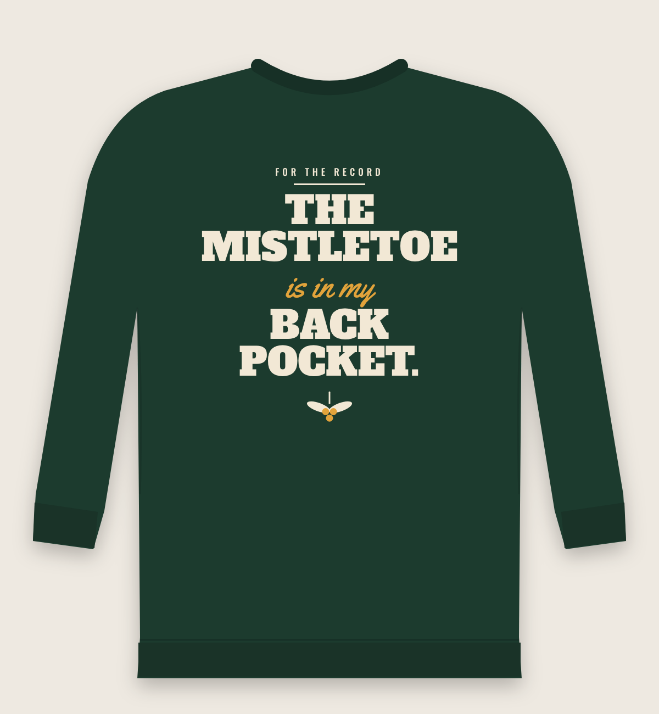

For a while I've wanted to start a venture that brings friends together once in a while, pays for itself, and maybe even makes a little money. The idea is to combine what each of us already knows how to do with AI, which now handles a lot of the design, research and planning. This is the first test: a holiday sweatshirt, designed and planned with Claude in one evening.

## The starter product

**"The Mistletoe is in my Back Pocket."** It's a deadpan holiday joke in retro lettering on a forest green crewneck. The artwork is original, so we're free to sell it.

| Item | Choice | Why |
|---|---|---|
| Sweatshirt | Comfort Colors 1566 crewneck, 9.5 oz, garment-dyed | Soft, vintage feel that suits the retro look |
| Color | Dark green | Holiday color; cream ink stands out on it |
| Print | Screen print, full front, 1 ink color (cream) | Cheapest setup; holds up in the wash |
| Optional 2nd ink | Gold accents | About $15 more in setup; save it for a reorder |

## The plan in one paragraph

Order 48 screen-printed sweatshirts by **Nov 24** and sell them by Christmas at **$45** each. The run costs about **$1,300** all in and breaks even at about **29 sold**. Selling out returns roughly **$850–$900** before fees. We take preorders this week to set the size split, then use print-on-demand to keep selling online without holding more stock.

## Initial order

**Order 1: bulk screen print (place by Nov 24)**

| Size | Qty |
|---|---|
| S | 5 |
| M | 12 |
| L | 15 |
| XL | 11 |
| 2XL | 5 |
| **Total** | **48** |

The size split follows a common unisex size curve and will be adjusted to match preorders.

| Run size | Price per piece | Setup | Total |
|---|---|---|---|
| 24 | $27.75 | $40 | $706 |
| **48 (plan)** | **$25.25** | **$40** | **$1,252** |
| 72 | $24.25 | $40 | $1,786 |

Prices are 4imprint's printed prices with one ink color included. We'll also get a quote from a local Urbana or Columbus shop.

**Order 2: print-on-demand (Dec 1).** The same design goes on Printful or Printify, linked to an online store. Nothing is paid upfront, and each piece is printed when it sells.

**Reorder rule:** if 70% of Order 1 is sold by Dec 5, order 24 more from a local shop that can deliver within a week.

## Pricing and break-even

| Channel | Price | Cost per piece | Gross per piece |
|---|---|---|---|
| Preorder (paid upfront) | $40 | ~$27 | ~$13 |
| In person | $45 | ~$27 | ~$18 |
| Online, print-on-demand | $52 + shipping | depends on the print-on-demand quote | |

| Sold | Revenue at $45 | Profit |
|---|---|---|
| 24 | $1,080 | −$220 |
| 29 | $1,305 | break-even |
| 40 | $1,800 | $500 |
| 48 | $2,160 | $860 |

Leftover stock isn't wasted: a holiday design keeps until next November.

## Where we'll sell

| Channel | When | Target |
|---|---|---|
| Preorders: friends, family, Facebook | Nov 20–24 | 10–15 |
| Holiday markets and craft fairs (Urbana, Westerville, Columbus) | Dec 10–20 | 20–25 |
| Local shops on consignment | Dec 10–24 | 5–10 |
| Facebook Marketplace and local groups | Dec 8–22 | 5–10 |
| Print-on-demand online store | Dec 1 onward | Open-ended |

## Timeline

| Date | Step |
|---|---|
| Nov 20–24 | Take preorders, get quotes, book market booths |
| Nov 24 | Approve the proof and place the order |
| Nov 25 – Dec 8 | Printing and shipping |
| Dec 1 | Online store live |
| Dec 5 | Reorder decision |
| Dec 8–24 | Markets and local sales |

The Dec 8 arrival assumes about a week to print plus shipping. A shop that quotes 12 business days pushes arrival to about Dec 11–14, so we'll get a firm ship date before approving the proof.

## Startup budget

| Item | Cost |
|---|---|
| 48 printed sweatshirts | $1,212 |
| Screen setup (1 color) | $40 |
| 2XL surcharge | ~$15 |
| Bags, size stickers, price signs | ~$25 |
| **Total before booth fees and licenses** | **~$1,292** |

## Risks

| Risk | Fallback |
|---|---|
| Order arrives late | Local printer with a firm date; preorders delivered late |
| Wrong size mix | Sizes set from preorders; missing sizes go to print-on-demand |
| Slow sales | $40 after Dec 20; hold the rest for next year |
| Color not in stock | Closest shade in stock: forest, navy or burgundy |
| Sales tax and licensing | Confirm Ohio vendor's license coverage before the first market |

## How you can join in

If you'd like to help, whether that's selling at a market, spreading the word, designing the next item or just buying one, let me know. If this one works, the next product (and the next get-together) is already in the plan.

**Sources:** [4imprint, Comfort Colors printed pricing](https://www.4imprint.com/product/143146-S/Comfort-Colors-Garment-Dyed-Crew-Sweatshirt-Screen) · [4imprint, setup fees](https://www.4imprint.com/product/146704-S/ComfortWash-Garment-Dyed-Sweatshirt-Screen) · [Rush Order Tees, size breakdown](https://www.rushordertees.com/blog/how-to-order-sizes-for-group-t-shirts) · [Custom Ink, bulk pricing tiers](https://www.customink.com/blog/custom-sweatshirts-business-guide/)
